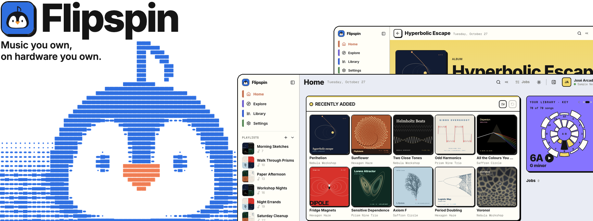
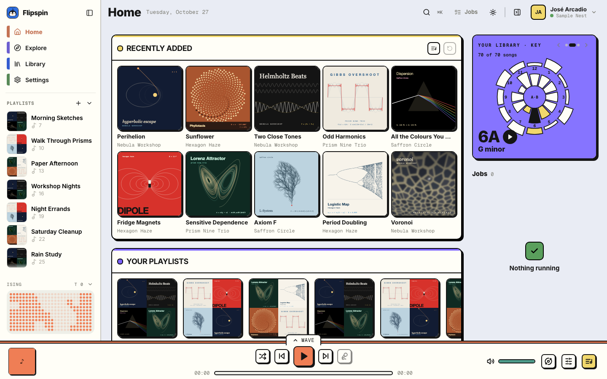

<p align="center">
  <picture>
    <source media="(prefers-color-scheme: dark)" srcset="docs/images/readme-cover-dark.png">
    
  </picture>
</p>

<p align="center"><b>A self-hosted music server that syncs lyrics, splits stems and detects key and tempo, on your own hardware.</b><br>
Your library on the desktop app and on any OpenSubsonic client.</p>

<p align="center">
  <a href="#install">Install</a> ·
  <a href="#features">Features</a> ·
  <a href="docs/tour.md">Tour</a> ·
  <a href="#documentation">Docs</a> ·
  <a href="https://github.com/flipspin/flipspin/discussions">Discussions</a>
</p>

<p align="center">
  <a href="https://github.com/flipspin/flipspin/releases/latest"></a>
  <a href="LICENSE"></a>
  <a href="https://github.com/orgs/flipspin/packages/container/package/flipspin-server"></a>
</p>

```sh
curl -fsSL https://raw.githubusercontent.com/flipspin/flipspin/main/deploy/install.sh | sh
```

Then open the desktop app for [macOS, Windows or Linux](#install) and point it at your server.

<picture>
  <source media="(prefers-color-scheme: dark)" srcset="docs/images/home-dark.png">
  
</picture>

## Features

**Library and server**
- Reads the library you already have: albums at **any folder depth**, disc folders merged, files never moved or renamed.
- **Multiple users**: owner and member roles, a personal library and playlists per account, one revocable token per device.
- **OpenSubsonic API**, so existing Subsonic and OpenSubsonic apps on Android, iOS, desktop and web browse, search and stream, with synced lyrics.
- **Remote access** through Tailscale, WireGuard or a domain with HTTPS; clients learn every address the server has and use the first that answers.
- Discovered on the local network over mDNS; a new device signs in with a code approved from one already signed in.

**Listening**
- **Synced lyrics** from LRCLIB, or aligned to the vocals when only the words are known, stored as `.lrc` beside the audio.
- **Stems**: drums, bass, vocals and other, mixed live in the player with a dB fader, mute and solo per stem.
- **Key and tempo** for every song you add (the rest of the library on request), a rough **mood** from tempo and energy, ReplayGain levelling and play history.
- Desktop downloads for offline listening, kept on that device only.
- A **full-screen visualizer** drawn from the song that is playing.

**Acquisition**
- **Catalog browsing** of Deezer's albums, artists and playlists, with every track you already own marked; one search box covers your library and the catalog.
- **Track identity** by ISRC and MusicBrainz recording ID; a match is graded strong, review or rejected before anything is downloaded.
- **Spotify import** from the privacy export (`my_spotify_data.zip`), with no account link or Premium needed.
- **Audio sources are plugins**: none is bundled, and a known source installs with one button from Settings. See [source plugins](docs/source-plugins.md).

**Machine learning, on your own hardware**
- **Lyrics alignment**: the words you already have, placed on the song from the isolated vocals.
- **Stem separation** into drums, bass, vocals and other.
- **Key and tempo** detection, benchmarked on GiantSteps; uncertain values are marked as estimates.
- Runs on any computer in the house that joins as a helper: Apple Silicon, Nvidia or CPU. [Models and accuracy](docs/machine-learning.md).

A walk through the screens: [docs/tour.md](docs/tour.md).

## Install

**Server**, one line (Debian, Ubuntu, Proxmox LXC, Raspberry Pi OS · amd64 / arm64):

```sh
curl -fsSL https://raw.githubusercontent.com/flipspin/flipspin/main/deploy/install.sh | sh
```

Or Docker Compose:

```yaml
services:
  flipspin:
    image: ghcr.io/flipspin/flipspin-server:latest
    ports: ["8000:8000"]
    volumes:
      - /path/to/music:/music
      - ./data:/data
    restart: unless-stopped
```

Then get the setup link and paste it in the desktop app (Setup link):

```sh
docker compose logs flipspin | grep -A3 "krobi://"
```

Unraid: the template in [deploy/unraid](deploy/unraid). Flags, reverse proxies, systemd and from-source: [docs/deployment.md](docs/deployment.md).

**Desktop app**, which can also run its own server:

| macOS | Windows (preview) | Linux (preview) |
|---|---|---|
| [.dmg](https://github.com/flipspin/flipspin/releases/latest) · Apple Silicon | [.exe](https://github.com/flipspin/flipspin/releases/latest) · x64 | [.AppImage · .deb](https://github.com/flipspin/flipspin/releases/latest) · x64 |

Windows and Linux builds pass automated checks but have not been tested hands-on yet. The builds are unsigned; see [installation steps](docs/INSTALL.md) for the macOS and Windows prompts. Before updating, read [Upgrading and backups](docs/upgrading.md).

**Clients**: the Flipspin desktop app, or any OpenSubsonic app. Native Android and iPhone apps are in development.

## Documentation

- [Deployment](docs/deployment.md) · [Configuration](docs/CONFIGURATION.md) · [Upgrading and backups](docs/upgrading.md) · [Remote access](docs/features/remote-access.md)
- [OpenSubsonic compatibility](docs/features/opensubsonic.md) · [API compatibility](docs/API_COMPATIBILITY.md)
- [Machine learning: models and accuracy](docs/machine-learning.md) · [Lyrics alignment](docs/lyrics-align.md) · [Stems](docs/stems.md) · [Song analysis](docs/analysis.md)
- [Architecture and design principles](docs/architecture.md) · [Contributing](CONTRIBUTING.md) · [Plugins](docs/PLUGINS.md)

## FAQ

**Does the server need a GPU?**
No. Lyrics sync, stem separation and song analysis run on helper machines that connect to the server: Apple Silicon (MLX), Nvidia (CUDA) or a plain CPU. The server can run some of this work on its own CPU, more slowly, if you allow it.

**Which external services does it contact?**
Only the metadata and lyrics sources enabled in Settings and the audio source plugins you install, plus one daily release check that can be turned off. No telemetry.

**Does it modify my files?**
It never moves or renames them. Tags are written only if analysis tag writing is enabled.

**Is there a mobile app?**
Any OpenSubsonic client works today. Native Android and iOS apps are in development.

**Which languages are supported?**
English. Spanish is coming soon.

## License

AGPL-3.0. Flipspin does not provide any music. See the [legal notice](docs/legal.md).

<sub>Screenshots show an invented library with procedural covers, generated by <code>node scripts/make-readme-shots.mjs</code>.</sub>
