# A tour of Flipspin

The screens behind the [README](../README.md), with an invented library and procedural covers generated by `node scripts/make-readme-shots.mjs`.

<picture>
  <source media="(prefers-color-scheme: dark)" srcset="images/home-dark.png">
  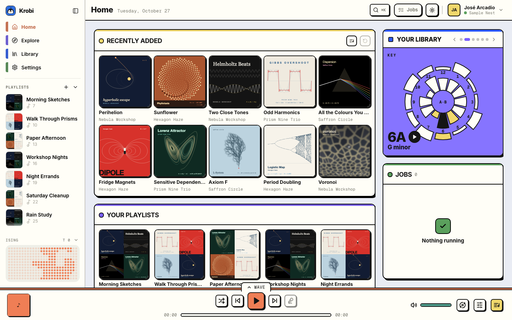
</picture>

## Features

<table>
<tr>
<td width="50%" valign="top">
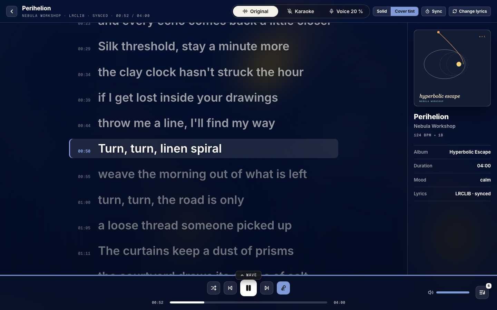<br>
<b>Synced lyrics</b><br>
Fetched from LRCLIB. When only the words are known, a helper machine aligns them to the isolated vocals, line by line. Stored as <code>.lrc</code> next to the audio file.
</td>
<td width="50%" valign="top">
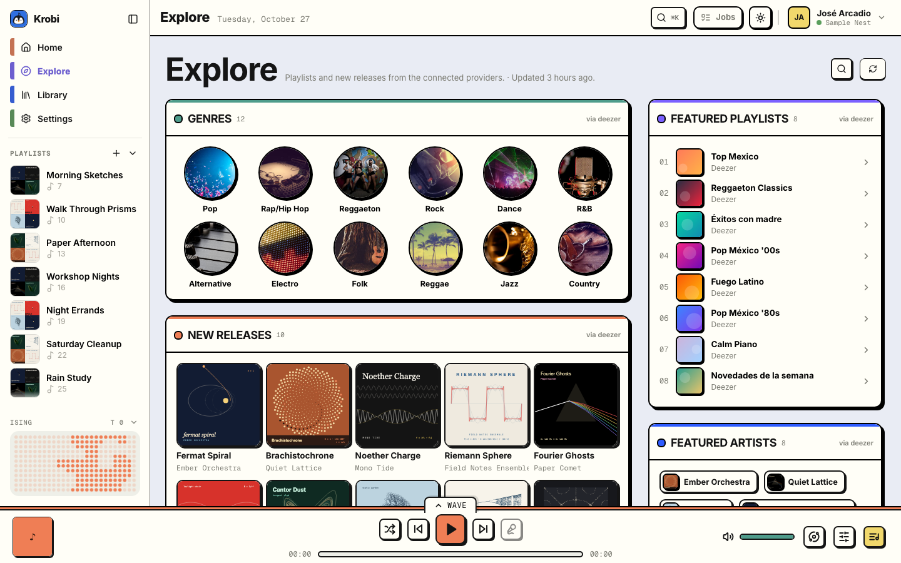<br>
<b>Catalog browsing with ownership</b><br>
Search albums, artists and playlists from Deezer and MusicBrainz. Tracks already in the library are matched by ISRC, or by normalized title and duration, and marked.
</td>
</tr>
<tr>
<td colspan="2" valign="top">
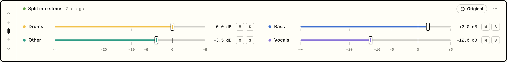<br>
<b>Stem separation</b><br>
Drums, bass, vocals and other, separated with Demucs on a helper machine and stored on the server as Opus. The player mixes them live: a dB fader, mute and solo per stem, and a karaoke preset.
</td>
</tr>
<tr>
<td width="50%" valign="top">
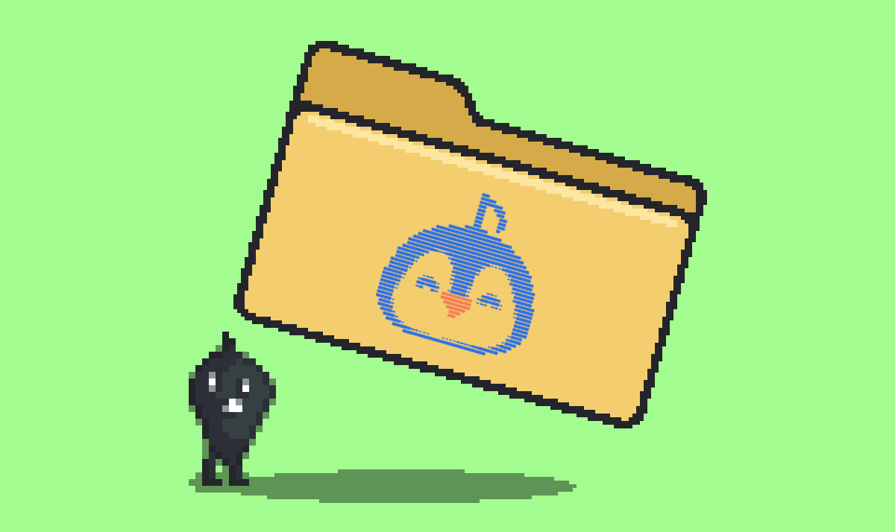<br>
<b>Import from Spotify</b><br>
Upload Spotify's privacy export (<code>my_spotify_data.zip</code>, requested at spotify.com/account/privacy) in Settings → Library → Import. No Spotify account link or Premium needed. Playlists you own can also be re-synced from Spotify, which needs your own Spotify developer app and Premium.
</td>
<td width="50%" valign="top">
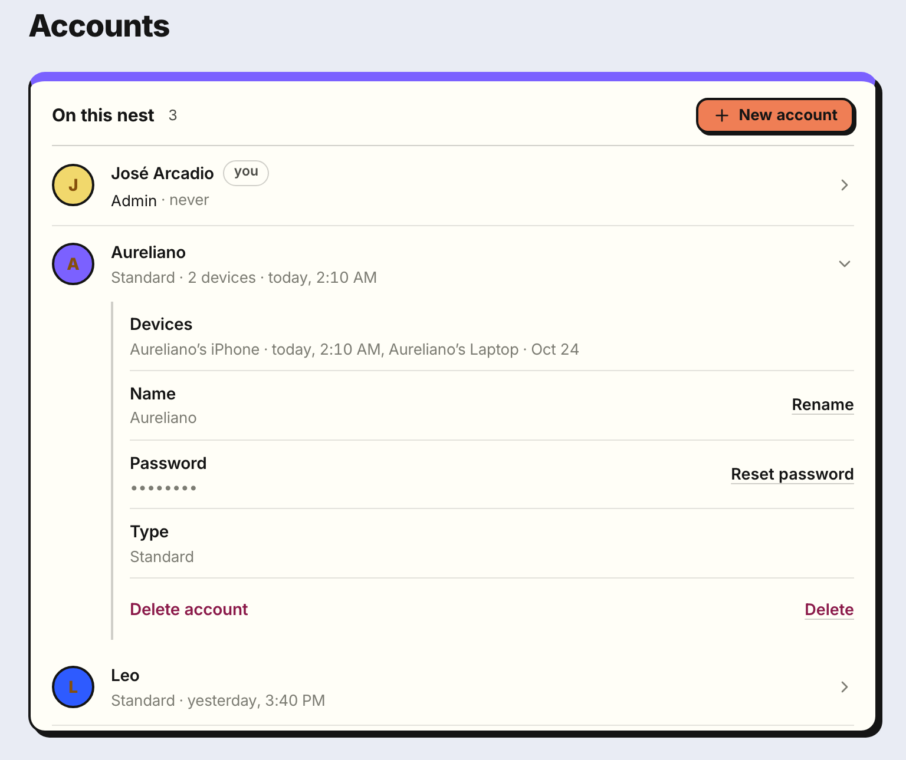<br>
<b>Accounts and devices</b><br>
Owner and member roles, a library view and playlists per user, and one revocable token per device.
</td>
</tr>
<tr>
<td width="50%" valign="top">


```
GET /rest/ping
GET /rest/getAlbumList2
GET /rest/search3
GET /rest/stream
GET /rest/getLyricsBySongId
```

<b>OpenSubsonic API</b><br>
Existing Subsonic and OpenSubsonic clients on Android, iOS and desktop browse, search and stream the library, with synced lyrics through the <code>songLyrics</code> extension.
</td>
<td width="50%" valign="top">

```
Music/
├── Artist/Album/01 Song.flac
├── Album (2019)/CD1/01.mp3
├── Album (2019)/CD2/01.mp3
└── loose-album/track.ogg
```

<b>Any folder layout</b><br>
Albums are detected at any folder depth, and disc folders (CD1, Disc 2) are merged into their album. Files are never moved or renamed.
</td>
</tr>
</table>

## Screens

<table>
<tr>
<td width="50%"><br><b>Home</b> · recently added, your playlists, active downloads</td>
<td width="50%">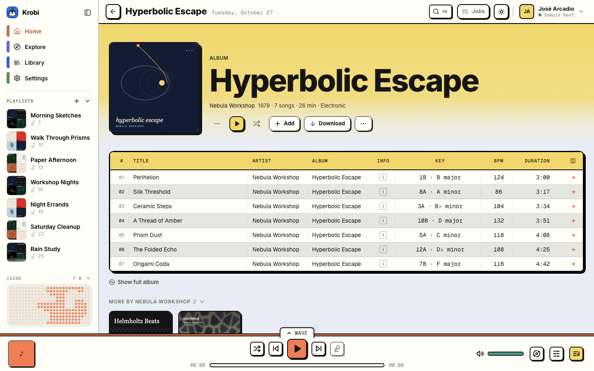<br><b>Album</b> · tempo and key for every song</td>
</tr>
<tr>
<td width="50%">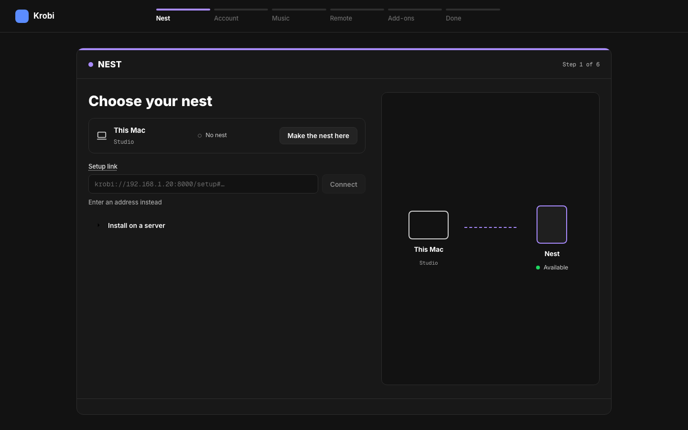<br><b>First run</b> · this computer, another one on your network, or a server</td>
<td width="50%">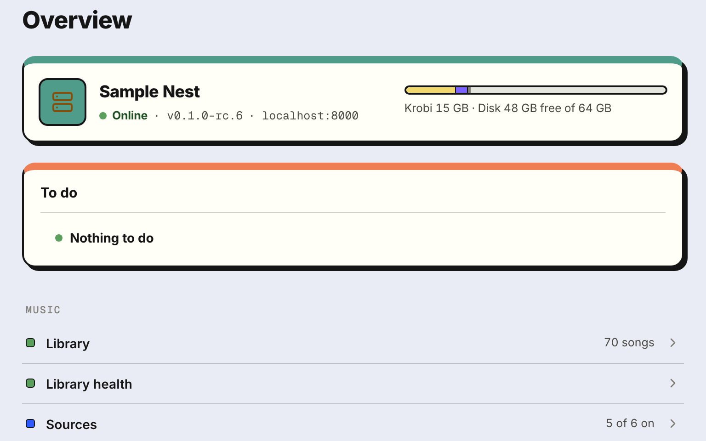<br><b>Settings</b> · server, accounts, devices, remote access</td>
</tr>
</table>

## Visualizer

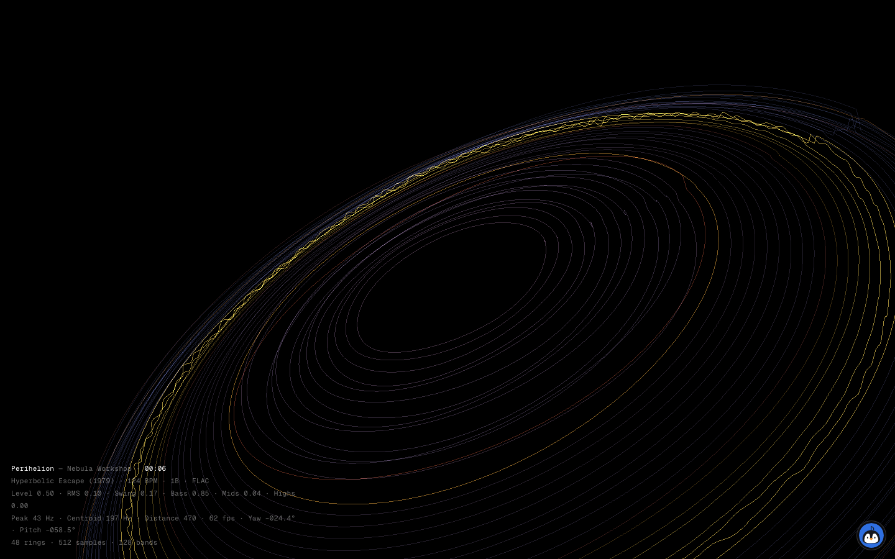

Press <kbd>D</kbd> while a song plays: rings drawn from its waveform, with a readout of tempo, key and levels.

## Remote access

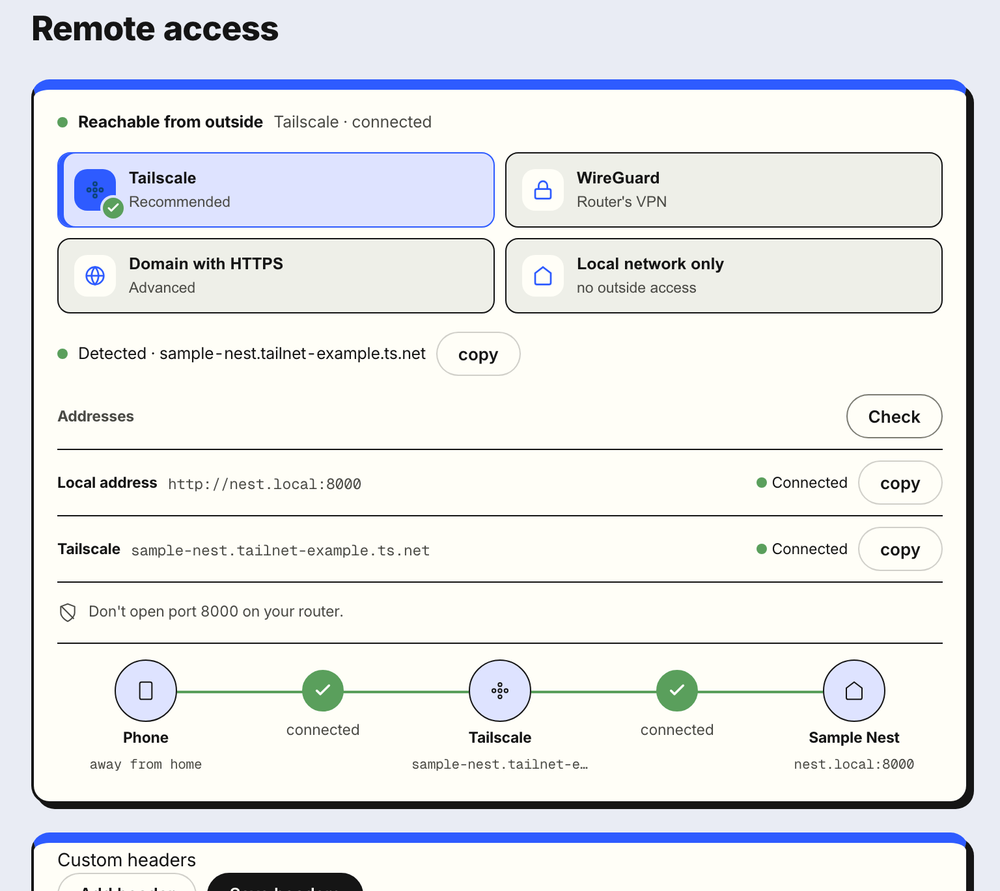

Settings → Nest → Remote access: Tailscale, WireGuard on your router, or a domain with HTTPS. Details in [remote access](features/remote-access.md).
